## Head Measurement

*Step 1:* Measure around the head like a baseball cap (\~1.5 - 2 cm / \~½–1 inch above eyebrows).\
*Step 2:* If between sizes (e.g., 57), start smaller (e.g., 56) and go up if the cap is too tight.\

::: {.callout-tip title="Available Cap Sizes:"}
**54, 56, 58, 60**
:::

::: {layout-nrow="2" title="Head Measurement & Cap Size"}
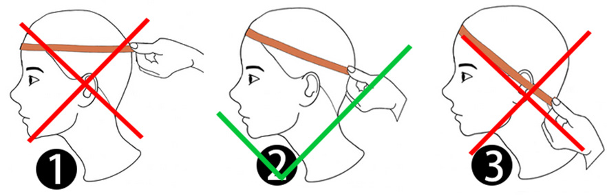{width="100%" fig-align="left"}

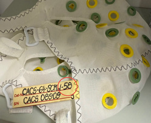{width="30%" fig-align="left"}
:::

## Putting on the Cap

*Step 1:* Ask participant to hold the back tag to help you get the cap on their head.
*Step 2:* Pull cap on from back to front.
*Step 3:* Ask them to keep their head up straight and steady.
*Step 4:* Place your hand on the top of their head.
*Step 5:* Slide the cap until it gets roughly to the right position.
*Step 6:* Ask them to identify their occipital bone bump (back of head).

::: {layout-ncol="3" title="Putting on the Cap"}

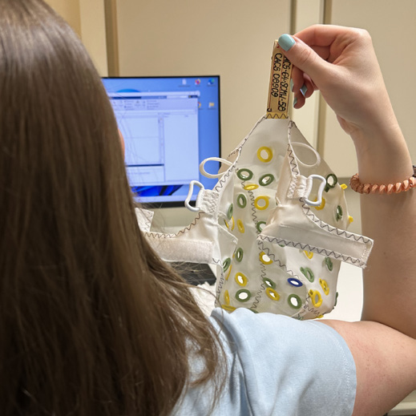{width=80% fig-align="left"}

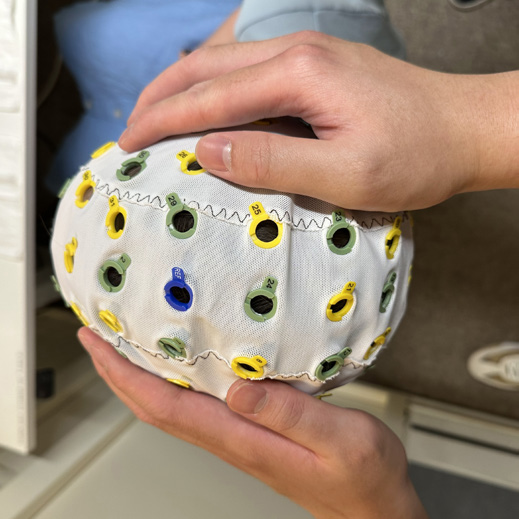{width=80% fig-align="left"}

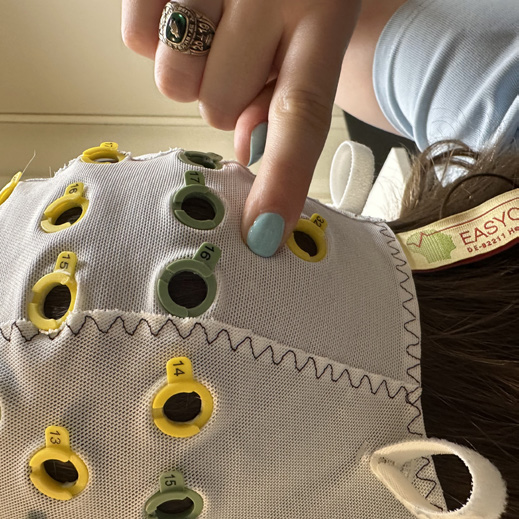{width=80% fig-align="left"}
:::

## Check Reference Location

*Step 1:* Measure from the spot between eyebrows to the occipital bump. \
*Step 2:* Measure from ear to ear. The reference electrode should be  approximately midpoint between eyebrows and occipital bone as well as midpoint between the ears.\
Note: This should result in the ground electrode being slightly above the eyebrows, but below the mid-forehead.\
*Step 3:* Adjust cap again as described above if needed.\

::: {layout-ncol="3" title="Check Reference Location"}

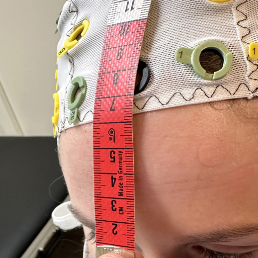{width=80% fig-align="left"}

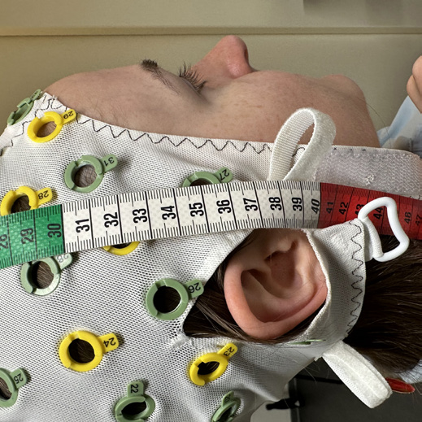{width=80% fig-align="left"}

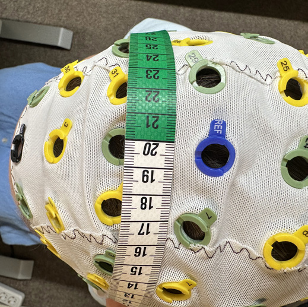{width=80% fig-align="left"}
:::

## Chin Strap

*Step 1:* Ask participant to fasten chin strap themselves.

## Plugging in the Electrodes

*Step 1:* Match Electrode Band 1–32 and 33–64 to the amplifier. 
*Step 2:* Use arrow on plug (top right) to align with amplifier port.
*Step 3:* Insert straight in — do not bend, force, or wiggle.
*Step 4:* Plug GND (ground electrode) separately into port labeled “GND” (round plug).

::: {layout-ncol="2" title="Plugging in the Electrodes"}

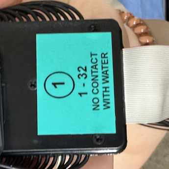{width=80% fig-align="left"}

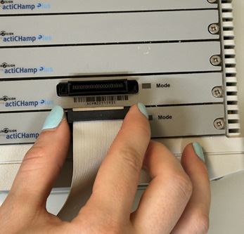{width=80% fig-align="left"}

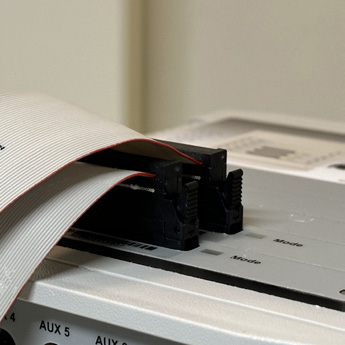{width=80% fig-align="left"}

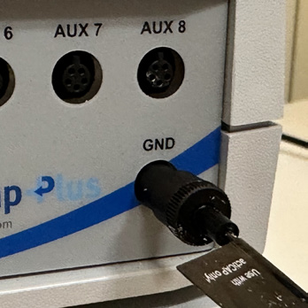{width=80% fig-align="left"}

:::

