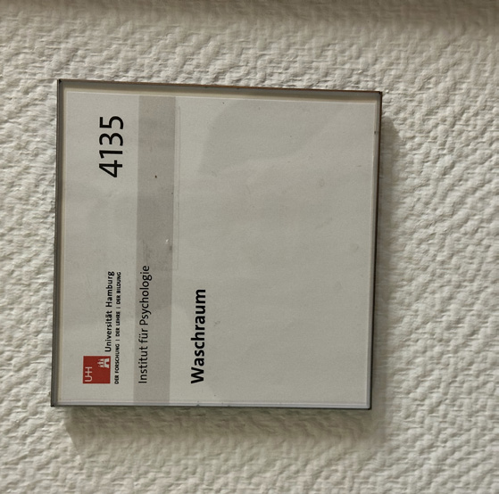
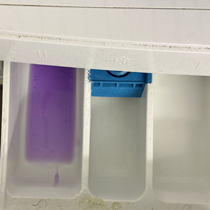
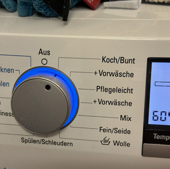
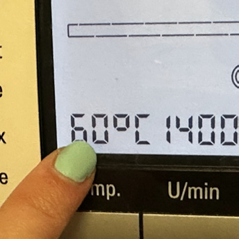
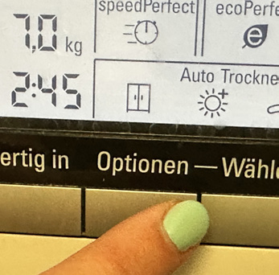

# Closing the Lab

*Step 1:* Shut down both computers.\
*Step 2:* Ensure at least 2 clean towels are ready for the next day. If not, do laundry in Room 4135 (will need about 4.5 hours to complete).

{width=40% fig-align="left"}

*Step 3:* Lock all the doors.

## Laundry Instructions

### Siemens Washer/Dryer settings
*Step 1:* Put the laundry detergent in the left-hand compartment.\
*Step 2:* Set the washing program on “Koch/Buntwasche”.\
*Step 3:* 60 degrees.\
*Step 4:* Choose quick cycle on the screen.\
*Step 5:* Choose drying cycle to be the wardrobe.\

::: {layout-ncol="2" title="Laundry Instructions"}

{width=80% fig-align="left"}

{width=80% fig-align="left"}

{width=80% fig-align="left"}

{width=80% fig-align="left"}

:::