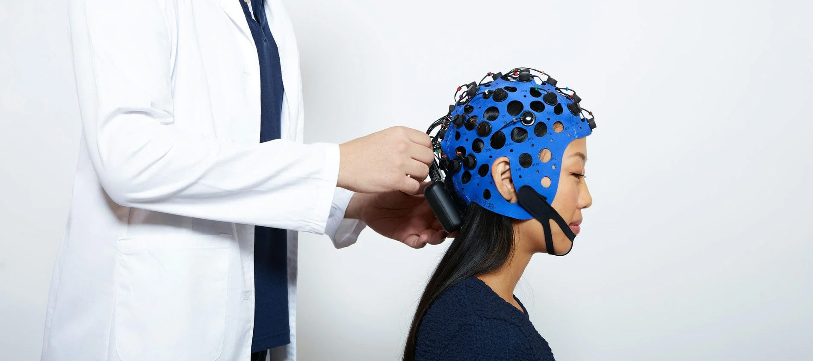

This document is a guide on how to use the EEG lab for a testing session. Depending on your specific study, some steps might be added or modified. Nevertheless, this guide is the basis for a clean and smooth testing procedure. All rules should be respected, unless the primary investigator for your study tells you otherwise.

::: {.callout-important title="WARNING"}
**As the EEG equipment is very expensive and some parts of the equipment are also fragile, the entire procedure should be done with great care. This document should be read carefully.**
:::

For any questions or in case of unexpected incidents, please reach out to the following people:

-   **Alexa Ruel** (alexa.ruel\@uni-hamburg.de ; office VMP5, Room 4077)
-   **Marit Petzka** (marit.petzka\@uni-hamburg.de)
-   **Nicolas Schuck** (nicolas.schuck\@uni-hamburg.de)
